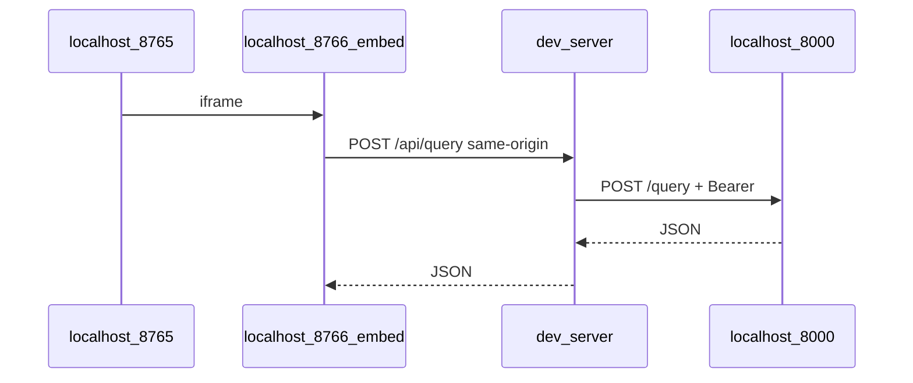

# Embeddable Santosha RAG chat — plan (Iframe repo)

*Source: Cursor plan `santosha_embed_chat_ui` · Last updated: October 17, 2026*

## Table of contents

1. [When to use this repo](#when-to-use-this-repo)
2. [Constraints](#constraints)
3. [Split with documentation-helper](#split-with-documentation-helper)
4. [API contract (upstream)](#api-contract-upstream)
5. [Phase 1 — Local dev](#phase-1--local-dev-no-cors-on-rag-required)
6. [Phase 2 — Vercel staging and production](#phase-2--production-like-staging-and-go-live-vercel)
7. [CORS](#cors--where-it-applies-keep-it-simple)
8. [Target layout](#embed-repo-layout-vanilla--vercel)
9. [Implementation todos](#implementation-todos)
10. [Testing checklist](#testing-checklist)
11. [Risks](#risks--complexity-explicit)
12. [Out of scope](#out-of-scope)

---

## When to use this repo

| Timing | Action |
|--------|--------|
| **Now** | Repo scaffold, `AGENTS.md`, this plan — **no RAG code here** |
| **When RAG API works locally or on Render** | Implement Phase 1 (`dev_server.py`, embed UI, demo parent) |
| **Before Santosha go-live** | Phase 2 Vercel preview (`/demo` + `/embed/` + `/api/query`) |
| **Go-live** | Santosha developer embeds production Vercel iframe URL; tighten CSP `frame-ancestors` |

Do **not** add embed static files or Vercel config to `documentation-helper`.

---

## Constraints

- **No santoshapilates.com in development** — localhost for day-to-day; **Vercel preview** for HTTPS + iframe header behavior before go-live.
- **Do not grow documentation-helper** — RAG on Render stays API-only for v1.
- **Production controls (CORS, CSP)** — implemented here on **Vercel**, not in the RAG Dockerfile.

---

## Split with documentation-helper

| | **documentation-helper** | **Iframe** (this repo) |
|---|--------------------------|------------------------|
| Role | Ingest, Pinecone, `POST /query` on Render | Widget, mock parent, dev proxy, Vercel BFF |
| Browser never sees | `GEMINI_API_KEY`, `RAG_SERVICE_SECRET` | Same — secret only in dev `.env` / Vercel env |

---

## API contract (upstream)

From sibling [`rag_api_gemini.py`](../documentation-helper/rag_api_gemini.py):

- `GET /health` — vector readiness (no Gemini).
- `POST /query` — `{ "query": "..." }` → `{ "answer", "sources", "vectorBackend", "responseTimeMs" }`.
- Auth: if `RAG_SERVICE_SECRET` set, `Authorization: Bearer <secret>` (**server-side only**).

Single-turn RAG per request (same as Streamlit). UI chat history is client-only until upstream adds `messages[]`.

Future: [`documentation-helper/docs/planning/RAG_API_CONTRACT.md`](../documentation-helper/docs/planning/RAG_API_CONTRACT.md) (to be added upstream).

---

## Phase 1 — Local dev (no CORS on RAG required)



- **`dev_server.py`**: static embed + `POST /api/query` → `RAG_API_URL` with Bearer.
- Mock parent frames widget (ports documented in README once implemented).
- **`sessionStorage`** UUID → `X-Embed-Session-Id`; in-memory turn limits on proxy.

---

## Phase 2 — Production-like staging and go-live (Vercel)

| Vercel feature | Purpose |
|----------------|---------|
| HTTPS preview URLs | Test iframe without Squarespace |
| Serverless `/api/query` | BFF → Render with Bearer |
| `vercel.json` headers | CSP `frame-ancestors`, optional CORS on `/api/*` |
| `/demo` route | Mock parent on `*.vercel.app` framing `/embed/` |

**Go-live snippet** (for Santosha admin — production host TBD):

```html
<iframe
  src="https://YOUR-VERCEL-HOST/embed/"
  title="Santosha Pilates assistant"
  style="border:0;width:100%;max-width:420px;height:560px;"
  loading="lazy"
></iframe>
```

Details: [`PRODUCTION_EMBED.md`](PRODUCTION_EMBED.md) (expand at Phase 2).

---

## CORS — where it applies (keep it simple)

| Call pattern | CORS needed? |
|--------------|--------------|
| Iframe → same-origin Vercel `/api/query` | **No** (default) |
| Browser → Render `/query` directly | **Avoid** — use BFF |
| Vercel BFF → Render | **No** (server-to-server) |

Optional upstream: `CORSMiddleware` on Render only if browser must hit RAG directly (discouraged).

---

## Embed repo layout (vanilla + Vercel)

| Path | Purpose |
|------|---------|
| `embed/` | `index.html`, `embed.css`, `embed.js` |
| `demo/` | Mock business site + iframe |
| `dev_server.py` | Local BFF + static |
| `api/query.py` or `api/query.ts` | Vercel handler |
| `vercel.json` | Routes + security headers |
| `.env.example` | `RAG_API_URL`, `RAG_SERVICE_SECRET`, limit knobs |

---

## Implementation todos

| ID | Status | Task |
|----|--------|------|
| new-repo-scaffold | **done** | Repo at `~/Projects/Santosha/Iframe`, AGENTS, PLAN |
| local-dev-proxy | **done** | `dev_server.py`, `embed/`, `demo/parent.html`, `lib/` |
| vercel-staging | **done** | `api/query.js`, `vercel.json`, `PRODUCTION_EMBED.md` |
| api-contract-doc | **done** | `documentation-helper/docs/planning/RAG_API_CONTRACT.md` |
| doc-helper-minimal | **done** | CORS deferral documented in contract (no Render middleware yet) |

---

## Testing checklist

**Local:** parent + iframe; proxy → RAG; 429 on turn limit.

**Vercel preview:** `/embed/`, `/demo`, `/api/query`; CSP headers; no secret in browser.

**Regression:** Render `POST /query` + Bearer unchanged.

---

## Risks / complexity (explicit)

- CSP `frame-ancestors` misconfiguration blocks embedding — test on Vercel before Squarespace.
- Squarespace parent CSP may block iframe src — Santosha dev validates.
- In-memory limits on serverless are per-instance (v1 acceptable).

---

## Out of scope

- Multi-turn RAG in upstream API.
- Database for sessions/quota.
- Embed code inside documentation-helper.
